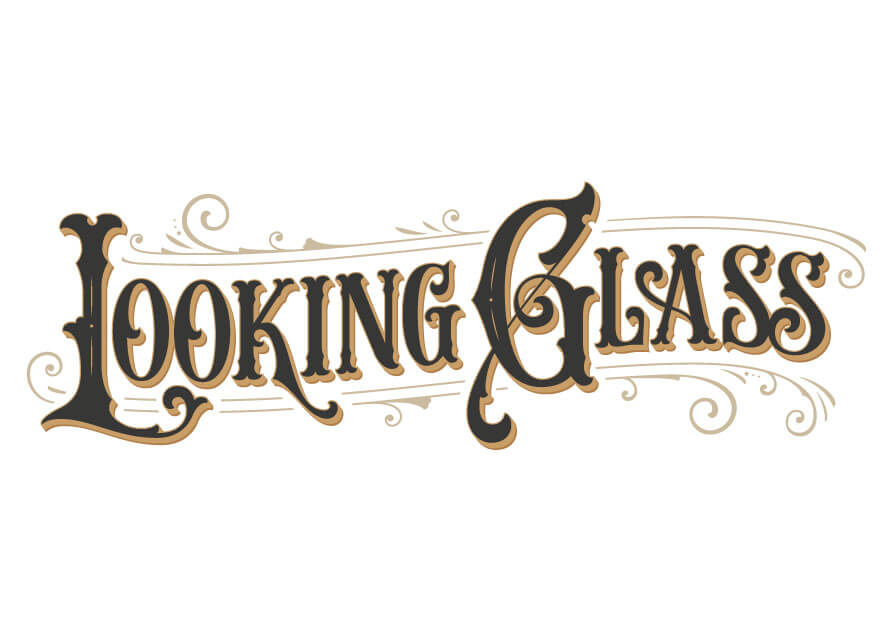

Windows to the past are open at last 
> *Note*: currently in early development


## requirements
* [Node.js](https://nodejs.org/) 18 LTS or 20 LTS (or current LTS)
* npm 9+ (bundled with Node)


## installation
```bash
git clone git@github.com:LookingGlassVR/lookingglass.git
cd lookingglass
npm install
```
### local environment
`npm run sync`

### staging deployment
```bash
npm run dev
./operations/ghpage.sh
```

### production deployment
Deploy syncs `public/` to S3 using the AWS CLI. The script does **not** use the old s3cmd config (`~/.s3LGfullaccess`); you must configure the AWS account that owns the Looking Glass bucket.

1. Configure a profile for that account (bucket name is typically `lookingglassvr`):
   ```bash
   aws configure --profile lookingglass
   ```
2. Deploy (script runs `npm run prod` then syncs to S3):
   ```bash
   ./operations/deploy.sh
   ```
   Optional env: `LOOKINGGLASS_AWS_PROFILE`, `LOOKINGGLASS_BUCKET`, `LOOKINGGLASS_CLOUDFRONT_ID`.

